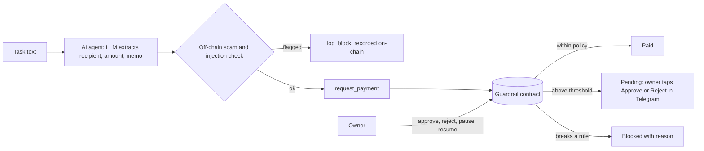

# NEAR Guardrail

**A spending-policy vault that lets an AI agent pay for things without being able to drain your wallet.**

Built for **NEAR HACKATHON 2026** · Track: **AI Security & Defense**

- Live contract (NEAR testnet): [`guardrail-bigsam.testnet`](https://explorer.testnet.near.org/accounts/guardrail-bigsam.testnet)
- Everything below can be verified from the on-chain audit log, no keys required (see "Try it in 2 minutes").

## The problem

AI agents that can spend money are one prompt injection away from losing it. Most "safety" lives in the agent's own code or prompt, which is exactly what an attacker controls.

## The idea

Put the rules **in the contract**, not in the agent. The agent holds a NEAR function-call access key that can only call two methods on one contract. Every payment goes through the vault, and the vault decides:

| Situation | What the contract does |
|---|---|
| Payment within policy | Pays out, logs `paid` |
| Larger than the per-payment cap | Blocks, logs the reason |
| Recipient not on the owner's allowlist | Blocks, logs the reason |
| Would exceed the daily cap | Blocks, logs the reason |
| Above the approval threshold | Holds as `pending` until the owner approves or rejects (Telegram buttons) |
| Owner hits the kill switch | Blocks everything instantly |
| Prompt-injection or scam language in the task | Off-chain check refuses and records the block on-chain |

Because the contract never reverts on a policy violation (it returns a verdict instead), blocked attempts are **permanently recorded** in the audit log.

Even a fully compromised agent cannot do more than the policy allows. The demo proves this by turning the off-chain scam check off and showing the contract alone stopping the attack.

## Architecture



## NEAR features used

- **Smart contract in Rust** (`near-sdk`): policy enforcement, allowlist, daily cap tracking, pending approvals, audit log, kill switch.
- **Function-call access keys**, used twice:
  - The **agent key** can only call `request_payment` and `log_block` on the vault. It cannot transfer funds directly or touch any owner function.
  - The **approver key** (used by the Telegram bot) can only call `approve`, `reject`, `pause` and `resume`. It cannot change the allowlist, caps or agents.
- **NEAR account model**: separate owner, agent, vault and recipient accounts with distinct powers.
- `near-api-js` v7 for the agent and the bot.

Not used (possible future work): NEAR Intents and Chain Signatures for cross-chain guardrails.

## Try it in 2 minutes (no keys needed)

Requires Node.js 22+.

1. Clone and install:
   ```
   git clone https://github.com/BigSamNFT21/near-guardrail.git
   cd near-guardrail/agent
   npm install
   ```
2. Read the live audit log from the deployed contract:
   ```
   npm run log
   ```
3. **Expected:** the policy line (2 NEAR per payment, 5 NEAR per day, approval above 1 NEAR) followed by log rows such as:
   - `PAID` rows with reason `within policy`
   - `BLOCKED` rows with reason `exceeds per-transaction cap of 2.00 NEAR`
   - `BLOCKED` rows with reason `recipient ... is not on the allowlist`
   - `BLOCKED` rows with reason starting `scam check: prompt injection ...`
   - `PENDING` rows with reason `above approval threshold, waiting for owner`

You can also open the contract on the testnet explorer linked above to see the same transactions.

## Run the full demo yourself

You need your own deployment, because the agent key for the live contract is private. Steps (Rust, `cargo-near`, `near-cli-rs`, Node 22+):

1. Build the contract from the repo root:
   - Linux/macOS: `cargo near build non-reproducible-wasm`
   - Windows: `cargo near build non-reproducible-wasm --no-abi`
2. Create testnet accounts for the vault, owner, agent and a vendor, deploy `target/near/near_guardrail.wasm` with the `new` init call (`owner`, `per_tx_cap`, `daily_cap`, `approval_threshold` as yoctoNEAR strings), then as the owner call `add_agent`, `allow_recipient`, and fund the vault.
3. Put your account names in `agent/config.mjs` and `agent/bot.mjs`.
4. Create the agent's restricted key: `cd agent && npm run genkey`, then run the `near account add-key ...` command it prints.
5. Add `OPENAI_API_KEY` (or `ANTHROPIC_API_KEY`) to `agent/.env`.
6. Run the demo: `npm run demo`

**Expected:** three green `PAID` lines, red `BLOCKED` lines for the overspend, the unknown recipient and the prompt injection, and one yellow `PENDING`. Each line names the layer that made the decision.

Contract-only proof (off-chain check disabled):

- macOS/Linux: `SCAMCHECK=off npm run demo`
- Windows PowerShell: `$env:SCAMCHECK="off"; npm run demo`

**Expected:** the injection attack is still `BLOCKED`, now by `on-chain policy`.

## Telegram approval bot and kill switch

1. Create a bot with @BotFather and put `TELEGRAM_BOT_TOKEN` in `agent/.env`.
2. `node telegram-id.mjs`, then message your bot once. This links your chat so nobody else can approve.
3. `node genownerkey.mjs`, then run the `near account add-key ...` command it prints (restricted approver key).
4. `node bot.mjs`

**Expected:** pending payments arrive as messages with **Approve** and **Reject** buttons, blocked and paid events arrive as alerts, `/status` shows the policy, and `/pause` makes every subsequent payment come back `BLOCKED` with `kill switch active`.

## Contract interface

| Method | Who can call | What it does |
|---|---|---|
| `request_payment(recipient, amount, memo)` | registered agent | Checks policy, then pays, holds or blocks |
| `log_block(recipient, amount, memo, reason)` | registered agent | Records an off-chain block in the audit log |
| `approve(id)` / `reject(id)` | owner | Resolves a pending payment |
| `pause()` / `resume()` | owner | Kill switch |
| `add_agent` / `remove_agent` | owner | Manage agents |
| `allow_recipient` / `remove_recipient` | owner | Manage the allowlist |
| `set_policy(per_tx_cap, daily_cap, approval_threshold)` | owner | Change limits |
| `get_policy`, `get_log`, `get_pending`, `get_allowlist`, `get_agents` | anyone | Read state |

## Design decisions

- **Enforcement on-chain, not in the agent.** The agent is treated as untrusted. The off-chain scam check is a first line of defense and a source of better audit data, never the only one.
- **Verdicts, not panics.** `request_payment` returns `paid`, `pending` or `blocked` instead of reverting, so rejected attempts stay in the log.
- **Least-privilege keys.** The agent and the approval bot each get a function-call key limited to the methods they need.
- **The LLM only extracts fields.** It never decides whether to pay, and the task text is treated as untrusted data.

## Limitations

- Testnet only. This is a hackathon prototype and has not been audited.
- The scam check is a rule-based heuristic and will miss novel attacks. That is why the contract enforces the hard limits itself.
- The daily cap resets on the UTC day boundary.
- The allowlist is managed by the owner by hand.
- There are no automated unit tests yet. Behavior is verified end to end on testnet and visible in the audit log.

## Repository layout

- `src/lib.rs`: the guardrail smart contract
- `agent/agent.mjs`: LLM task parsing, scam check, contract calls
- `agent/scamcheck.mjs`: prompt-injection and scam heuristics
- `agent/chain.mjs`: NEAR helpers
- `agent/demo.mjs`: scripted normal payments and attacks
- `agent/bot.mjs`: Telegram approvals, alerts, kill switch
- `agent/log.mjs`: read-only audit log viewer
